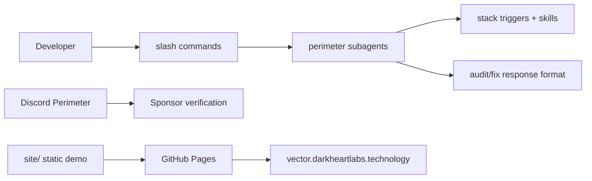

# Technical Specification — VECTOR / Shadow Gem

## Overview

Cursor plugin packaging 20 perimeter subagent personas, slash commands, stack triggers, and commercial Shadow Gem SKU documentation.

## Architecture

## Components

| Path | Responsibility |
|------|----------------|
| `agents/` | Subagent definitions |
| `commands/` | Slash command wiring |
| `skills/shadow-perimeter-personas/` | Persona behavior specs |
| `packs/` | Product SKU documentation |
| `rules/` | Stack-based persona triggers |
| `discord/` | Community setup and bot scaffold |
| `site/` | Public visual demo (landing + perimeter console) |

## Visual demo

Static HTML/CSS/JS in `site/`, published by [`.github/workflows/pages.yml`](../.github/workflows/pages.yml). Hosting matches Ask (custom domain on GitHub Pages) and Metal Menders (Actions → Pages artifact). See [DEPLOY.md](DEPLOY.md).

| Path | Purpose |
|------|---------|
| `/` | Product landing |
| `/demo/` | Interactive tech-support console |

Transmissions are scripted from `site/assets/js/incidents.js` + `roster.js`. No model key.

## Distribution

- Local install: copy to `~/.cursor/plugins/local/vector`
- Commercial: Shadow Gem packs via GitHub Sponsors + Discord role verification

---

**Maintained by:** [Dark Heart Labs](https://darkheartlabs.technology)  
**Author:** Jennifer ([@jv-darkheartlabs](https://github.com/jv-darkheartlabs))  
**Site:** https://darkheartlabs.technology
