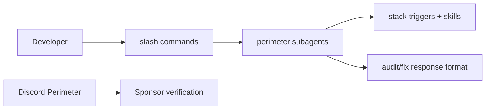

# Technical Specification — VECTOR / Shadow Gem

## Overview

Cursor plugin packaging 20 perimeter subagent personas, slash commands, stack triggers, and commercial Shadow Gem SKU documentation.

## Architecture

## Components

| Path | Responsibility |
|------|----------------|
| `agents/` | Subagent definitions |
| `commands/` | Slash command wiring |
| `skills/shadow-perimeter-personas/` | Persona behavior specs |
| `packs/` | Product SKU documentation |
| `rules/` | Stack-based persona triggers |
| `discord/` | Community setup and bot scaffold |

## Distribution

- Local install: copy to `~/.cursor/plugins/local/vector`
- Commercial: Shadow Gem packs via GitHub Sponsors + Discord role verification

---

**Maintained by:** [Dark Heart Labs](https://darkheartlabs.technology)  
**Author:** Jennifer ([@jv-darkheartlabs](https://github.com/jv-darkheartlabs))  
**Site:** https://darkheartlabs.technology
